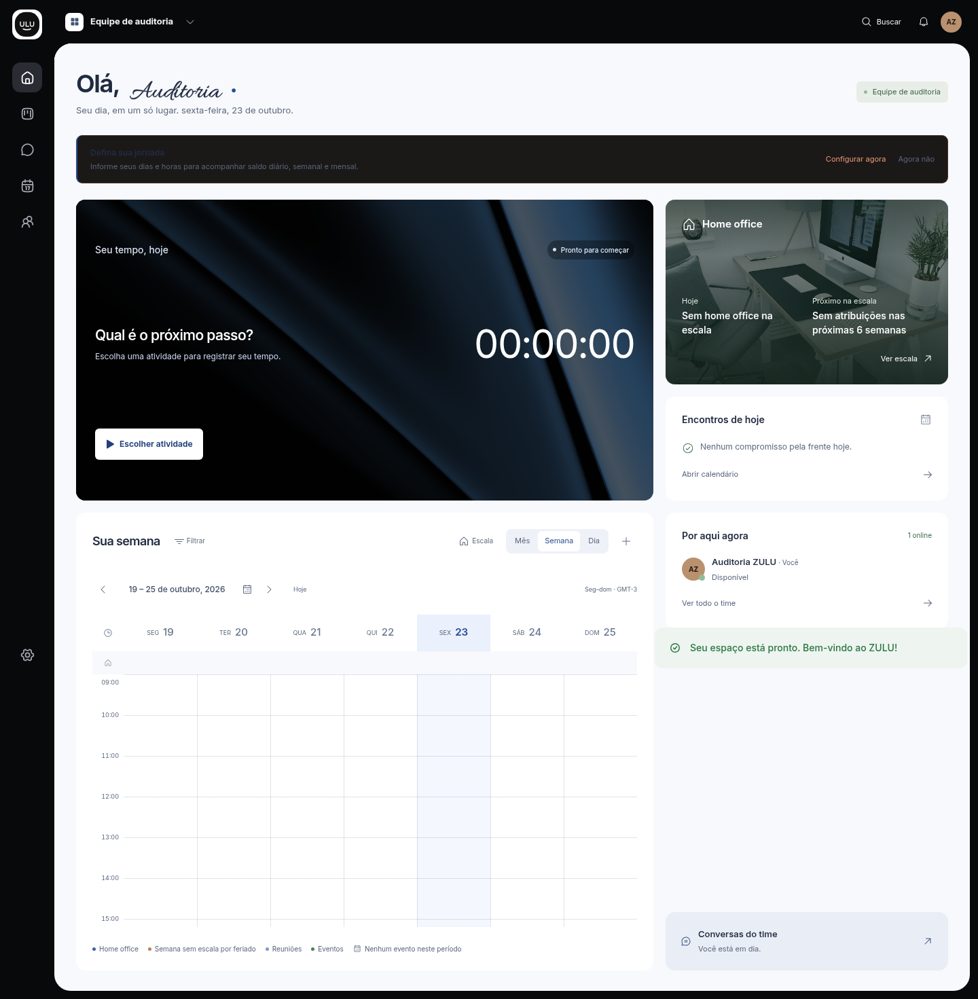
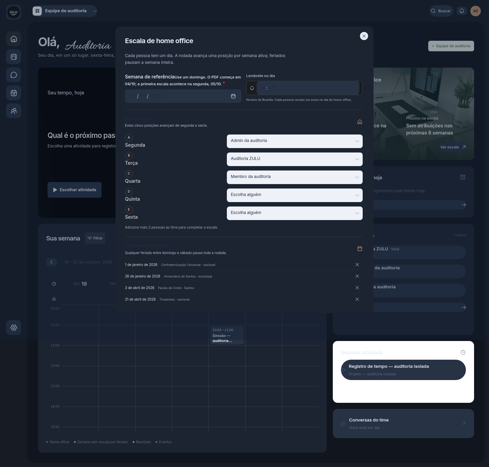
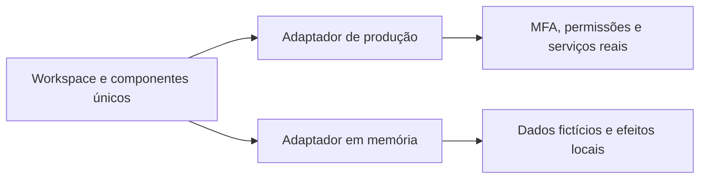

# ZULU — Auditoria da produção e plano do redesign integral

**Capturas de 23–24/10/2026, horário de São Paulo.** Fonte principal: https://hub-one-azure.vercel.app, autenticada com senha e MFA. Organização e três contas exclusivas de teste; os registros e nomes nas capturas são fictícios. A demonstração foi comparada separadamente.

## Resultado

O redesign precisa reconstruir a composição, a navegação e o sistema de componentes. A aplicação tem fluxos úteis funcionando, mas acumula apresentações paralelas e CSS que combina cores/estados incompatíveis. Compartilhar um componente interno não garante que a demonstração abra o mesmo formulário ou percorra o mesmo fluxo.

- **22 telas principais**, observadas em 1440×1000 e 390×1000, com estados vazios e depois dados de teste.
- **867 ocorrências de controles** inventariadas no conteúdo principal: [controls.csv](controls.csv). Não são controles únicos; calendário, tabs e dois tamanhos repetem instâncias.
- **530 ligações de eventos em 50 componentes** mapeadas no código, incluindo demos e campos: [source-actions.json](source-actions.json).
- **30 cenários exercitados**, com resultado por fluxo em [flows.csv](flows.csv). A presença no inventário é distinta de uma ação executada.
- **226 capturas arquivadas** em [assets](assets), com hashes em [assets.json](assets.json).
- Dono percorreu as 22 telas. Administrador e membro tiveram as telas Pessoas, Relatórios e Preferências verificadas; [roles.json](roles.json) detalha o escopo.
- Nenhum erro de página ou resposta HTTP ≥400 apareceu no levantamento inicial de navegação. Isso não comprova os efeitos que não foram executados.

## Correções delimitadas verificadas localmente

O candidato abaixo passou por build, **63 testes unitários** e **35 testes públicos** locais. A publicação e a conferência final em produção estão pendentes; a limpeza da organização e das contas de teste também está pendente. O estado atualizado de entrega fica em [delivery.json](delivery.json).

1. URLs antigas `/demo`, `/demo/calendar`, `/demo/kanban` e `/demo/operations` passam a encaminhar para as prévias mantidas. Os componentes antigos deixam de ser a entrada dessas URLs.
2. A busca global usa o mesmo catálogo de 22 páginas da navegação, com filtro de permissões e normalização de acentos, maiúsculas e espaços externos. O estado sem resultados usa a mesma lista filtrada. A produção anterior não retornava “Relatórios”.
3. O botão principal passa a usar o token semântico de primeiro plano. No login, o contraste medido passa de **2,33:1** para **8,13:1** no candidato local.
4. O botão de navegação móvel ganha fundo transparente no header e alvo de 44×44 px, preservando o ícone claro sobre a moldura escura.
5. A chamada integrada passa a caber na área útil da janela; controles conferidos em 1440×1000, 390×1000 e 1813×854 no app real com CSS candidato injetado. Isso valida enquadramento, não transmissão de mídia.
6. `AGENTS.md` exige auditoria da versão publicada com MFA e separa evidência real de mocks/fixtures.

Esses ajustes corrigem problemas delimitados. O novo design integral ainda depende da escolha de uma direção visual entre três conceitos em preparação; nenhuma nova linguagem visual foi implementada nesta entrega. As telas abaixo documentam a versão auditada antes dessa reconstrução.

### Sistema preservado e divergências documentadas

O candidato preserva o símbolo ZULU, Inter, as superfícies claras e o azul profundo do aplicativo, a moldura externa preta, HeroUI v3 e a identidade independente do site público. Preserva também os contratos funcionais e nativos; a mudança de enquadramento da chamada foi conferida no aplicativo real de produção com CSS candidato injetado, sem comprovar mídia real nem a publicação desse CSS.

`DESIGN.md` e `PRODUCT.md` continuam como registros existentes. Há descrições históricas em `PRODUCT.md` de uma lista menor de telas, rotas legadas da demonstração e validações então pendentes; elas não substituem a evidência desta auditoria. Esta entrega registra essa divergência sem reescrever a identidade ou reparar o histórico desses documentos. Os redirecionamentos das URLs legadas não resolvem a paridade de renderização, formulários e callbacks entre demonstração e produção.

## Achados prioritários

| ID | Prioridade | Evidência e efeito | Decisão para o redesign |
|---|---|---|---|
| A01 | Alta | Demo e produção têm montagens e callbacks diferentes. Horas na demo levam de volta ao dashboard; pessoas e perfil são simplificados; novo evento abre explicação demonstrativa. | Uma árvore de apresentação, com adaptadores de dados reais ou em memória. Os mesmos formulários e estados. |
| A02 | Alta | Jornada, perfil e escala misturam superfícies escuras com texto escuro ou campos claros dentro do tema escuro. | Tokens semânticos para superfície, texto, campo, seleção e foco; revisar portais nos dois temas. |
| A03 | Alta | Captura da chamada integrada tem 1139 px de altura num viewport de 1000 px; controles ficam além da primeira dobra. O fixture anterior ajustava a altura e omitia o shell. | Shell com área útil definida e palco flexível; controles de mídia sempre alcançáveis na janela real. |
| A04 | Alta | Busca global anterior omitia módulos existentes. Botão de login tinha 2,33:1. Ícone do menu móvel perdia contraste. | Correções delimitadas incluídas nesta entrega e regressão por papel/viewport. |
| A05 | Média | “Trabalho”, “Agenda” e “Configurações” repetem o nome do grupo como título, mesmo em módulos diferentes. | Nome da tela como título; grupo como navegação contextual. |
| A06 | Média | O primeiro saldo de jornada aparece negativo logo após configurar a conta; a interface não distingue claramente horas a cumprir e saldo fechado. | Explicar previsto, registrado, restante e banco, sem mudar o cálculo silenciosamente. |
| A07 | Média | Timer e imagem de home office dominam a primeira tela móvel; agenda, trabalho e equipe exigem longa rolagem. | Timer compacto e persistente; priorizar atividade atual, próximos compromissos e ações frequentes. |
| A08 | Média | Notas e Biblioteca usam linguagem próxima para funções diferentes; permissões e documentos ficam distantes. | Explicitar notas rápidas do time e biblioteca com acesso controlado; compartilhar padrões de editor e leitura. |
| A09 | Média | Formulários administrativos entram como blocos largos e extensos; usuários veem edição antes de contexto/resultado. | Listas com detalhe contextual, filtros compactos e edição progressiva. |
| A10 | Média | Abas móveis escondem destinos no eixo horizontal; a administração ainda acumula navegação em vários níveis. | Arquitetura responsiva com destino atual explícito e seleção acessível dos módulos. |
| A11 | Média | Tema escuro tem ilhas claras e textos pouco legíveis; modo escuro não acompanha todos os componentes. | Um contrato de tema para a árvore completa e seus overlays; não depender de correções isoladas por página. |
| A12 | Estrutural | O conjunto de CSS tem cerca de 13 mil linhas e mais de 100 declarações `!important`; demos legadas preservam outra linguagem. | Migrar por camadas, remover regras genéricas conflitantes e centralizar primitivas HeroUI. |

### Exemplos observados





## Telas principais — passos da auditoria

As evidências “populated” vieram da produção com os registros fictícios criados pela auditoria. Onde não havia dados para um ramo, o estado vazio e a limitação são registrados.

| Passo | Tela | Saúde observada / limite | Evidência |
|---|---|---|---|
| 1 | Hoje | **Reorganizar.** Timer real exercitado; aviso de jornada ilegível no primeiro acesso; composição muito alta no celular. | [Desktop](assets/populated-05-prod-overview-1440.png) · [Móvel](assets/populated-05-prod-overview-390.png) |
| 2 | Tarefas | **Reorganizar.** Criação de tarefa persistida; arraste, reordenação e arquivo não executados nesta rodada. | [Desktop](assets/populated-06-prod-board-1440.png) · [Móvel](assets/populated-06-prod-board-390.png) |
| 3 | Horas | **Reorganizar.** Timer, almoço, retomada e encerramento exercitados; separar saldo de dias fechados e horas a cumprir. | [Desktop](assets/populated-07-prod-hours-1440.png) · [Móvel](assets/populated-07-prod-hours-390.png) |
| 4 | Relatórios | **Ajustar.** PDF e CSV baixados com dados de teste; membro vê só o próprio escopo, admin tem filtro do time. | [Desktop](assets/populated-08-prod-reports-1440.png) · [Móvel](assets/populated-08-prod-reports-390.png) |
| 5 | Biblioteca | **Reorganizar.** Biblioteca e documento criados/editados; formulário de permissões inspecionado; concessão não submetida. | [Desktop](assets/populated-09-prod-library-1440.png) · [Móvel](assets/populated-09-prod-library-390.png) |
| 6 | Notas | **Reorganizar.** Estado carregado e editor observados; captura inicial de loading foi rejeitada como tela final. | [Desktop](assets/populated-10-prod-notes-1440.png) · [Móvel](assets/populated-10-prod-notes-390.png) |
| 7 | Metas | **Ajustar.** Formulário e números observados; gravação de meta não executada. | [Desktop](assets/populated-11-prod-goals-1440.png) · [Móvel](assets/populated-11-prod-goals-390.png) |
| 8 | Clientes | **Ajustar.** Criação/vínculo observados no formulário; persistência de cliente não executada. | [Desktop](assets/populated-12-prod-clients-1440.png) · [Móvel](assets/populated-12-prod-clients-390.png) |
| 9 | Mensagens | **Reorganizar.** Mensagem em canal persistida; canal, participantes e detalhes inspecionados; DM entre usuários não executada. | [Desktop](assets/populated-13-prod-chat-1440.png) · [Móvel](assets/populated-13-prod-chat-390.png) |
| 10 | Contatos | **Reorganizar.** Estado vazio e lista com contatos reais de teste observados; DM e chamada entre times pendentes. | [Desktop](assets/populated-14-prod-organization-chat-1440.png) · [Móvel](assets/populated-14-prod-organization-chat-390.png) |
| 11 | Chamadas | **Corrigir enquadramento.** Entrada acionada; estado Conectando capturado. Conexão/mídia não confirmadas no ambiente de auditoria. | [Desktop](assets/populated-15-prod-calls-1440.png) · [Móvel](assets/populated-15-prod-calls-390.png) |
| 12 | Notificações | **Ajustar.** Estado vazio e central flutuante observados; entrega push externa não executada. | [Desktop](assets/populated-16-prod-notifications-1440.png) · [Móvel](assets/populated-16-prod-notifications-390.png) |
| 13 | Calendário | **Reorganizar.** Criação de evento persistida e detalhes abertos; mês/dia/semana e filtro exercitados. | [Desktop](assets/populated-17-prod-calendar-1440.png) · [Móvel](assets/populated-17-prod-calendar-390.png) |
| 14 | Plantões | **Ajustar.** Formulário e estado vazio observados; troca/aprovação de plantão não executadas. | [Desktop](assets/populated-18-prod-shifts-1440.png) · [Móvel](assets/populated-18-prod-shifts-390.png) |
| 15 | Ausências | **Ajustar.** Formulário e estado vazio observados; solicitação/aprovação não executadas. | [Desktop](assets/populated-19-prod-absences-1440.png) · [Móvel](assets/populated-19-prod-absences-390.png) |
| 16 | Datas do time | **Ajustar.** Formulário e repetição anual observados; gravação não executada. | [Desktop](assets/populated-20-prod-dates-1440.png) · [Móvel](assets/populated-20-prod-dates-390.png) |
| 17 | Pautas e atas | **Ajustar.** Seletor e estado vazio observados; pauta/ata com evento selecionado pendentes. | [Desktop](assets/populated-21-prod-meetings-1440.png) · [Móvel](assets/populated-21-prod-meetings-390.png) |
| 18 | Pessoas | **Reorganizar.** Perfil e convite abertos; diferenças de dono/admin/membro observadas; e-mail não solicitado. | [Desktop](assets/populated-22-prod-people-1440.png) · [Móvel](assets/populated-22-prod-people-390.png) |
| 19 | Check-ins | **Ajustar.** Formulário e estado vazio observados; publicação não executada. | [Desktop](assets/populated-23-prod-standups-1440.png) · [Móvel](assets/populated-23-prod-standups-390.png) |
| 20 | Preferências | **Reorganizar.** Conta/preferências/desktop/organização e tema claro/escuro observados; controles Windows requerem Windows. | [Desktop](assets/populated-24-prod-settings-1440.png) · [Móvel](assets/populated-24-prod-settings-390.png) |
| 21 | Organização | **Reorganizar.** Sete seções inspecionadas; executor de aprovações múltiplas e transferência de dono não exercitados. | [Desktop](assets/populated-25-prod-organization-1440.png) · [Móvel](assets/populated-25-prod-organization-390.png) |
| 22 | Integrações | **Reorganizar.** Calendários, webhooks e auditoria observados; OAuth e entrega externa não autorizados nesta rodada. | [Desktop](assets/populated-26-prod-integrations-1440.png) · [Móvel](assets/populated-26-prod-integrations-390.png) |

## Acesso, público, demonstração e estados adicionais

| Grupo | Passos observados | Saúde / limite |
|---|---|---|
| Acesso | Login, cadastro, recuperação, MFA inicial e onboarding | Login/MFA e criação de organização concluídos; cadastro e recuperação observados sem solicitar e-mails. QR/chave TOTP não foram capturados. |
| Público | Site, download, privacidade, convite sem token, redefinição sem link | Páginas capturadas; estados sem token são estados esperados de proteção, não falhas de fluxo autenticado. Instalação/Store não executadas. |
| Demonstração | Dashboard, workspace, calendário, pessoas, chat e quatro entradas legadas | Parte do layout usa componentes atuais; fluxos e formulários continuam diferentes. Entradas legadas foram encaminhadas para as prévias mantidas. |
| Administração | Pessoas, Times, Convites, Aprovações, Funcionalidades, Políticas, Histórico | Sete seções inspecionadas; gravação de políticas, transferência de dono e aprovações múltiplas ficam para validação funcional específica. |
| Preferências | Conta, tema, desktop, organização e confirmação de exclusão | Tema alternado; ações Windows não executáveis neste ambiente. Exclusão exige nome exato e começou desabilitada. |
| Documentos | Criar biblioteca/documento, abrir, editar, salvar e inspecionar compartilhamento | Persistência exercitada; concessão/revogação e aprovação de compartilhamento não foram submetidas. |
| Trabalho | Nova tarefa, projeto, horas manuais, evento e seus detalhes | Tarefa/projeto/evento persistidos; horas manuais inspecionadas, timer persistido em fluxo separado. |
| Comunicação | Canal, membros, envio em canal, central de notificações e tentativa de chamada | Mensagem persistida; entrega em DM, push e transmissão real não comprovadas. |

Veja [flows.json](flows.json) para capturas por ação e [screens.json](screens.json) para o inventário completo das páginas/estados públicos. Tentativas de automação com seletor incorreto foram substituídas por casos corrigidos; elas não são tratadas como bugs do produto.

## Comparação que deve guiar o redesign

Compare o mesmo viewport, tema, papel e estado. Um timer fictício rodando e um timer real parado naturalmente mostram ações diferentes. O desvio estrutural relevante é abrir outro formulário, outra navegação ou outra árvore de apresentação.



As correções de URL não completam essa unificação. Ela é a primeira etapa do redesign, antes de produzir novas telas paralelas.

## Ordem de reconstrução

1. **Paridade de apresentação:** extrair shell, cabeçalhos, navegação e formulários compartilhados; a demo muda o adaptador, não a apresentação. Preservar validação, loading, erros e estados vazios reais.
2. **Nova linguagem:** substituir composição, escala tipográfica, superfícies, densidade e hierarquia. Marca ZULU pelo símbolo; HeroUI v3 continua obrigatório. Escolher uma direção visual concreta antes de multiplicar telas.
3. **Janela e navegação:** titlebar e sidebar integradas, área útil previsível, menus por teclado/toque, telas com título próprio. O runtime e os recursos de sistema do desktop continuam nativos.
4. **Uso diário:** Hoje, timer/almoço, tarefas, chat, chamadas e calendário. Timer compacto; ações contextuais; atenção ao foco e aos controles de mídia visíveis.
5. **Organização e informação:** pessoas, cargos exibidos, permissões, documentos, aprovações e relatórios; listas/detalhes progressivos. Não alterar regras de privacidade ou hierarquia para simplificar o visual.
6. **Acesso e distribuição:** onboarding, MFA, login, site, download e atualização desktop. Reutilizar tokens e componentes adequados ao contexto sem transformar a tela de trabalho em uma landing page.
7. **QA antes de publicar:** produção autenticada, papéis, dois temas, estados vazios/carregados, overlays, tamanhos de janela reais e recursos Windows. Publicar somente os estados que passaram, com limites explícitos.

## Critérios de aceite do novo design

- As 22 telas e os overlays usam a mesma família de componentes e tokens, em produção e em demonstração.
- Texto normal ≥4,5:1; elementos gráficos funcionais ≥3:1; foco visível, teclado e leitura de estados preservados.
- Móvel com alvos confortáveis, hierarquia sem grandes espaços improdutivos e controles críticos alcançáveis; janelas desktop também testadas na altura real.
- Preservar dados, MFA, RLS, permissões individuais, coroa/aprovações, feriados nacionais/Santos, banco de horas e pausa do almoço.
- Desktop usa APIs nativas para captura, arquivos e integração com o sistema; o redesign da interface não troca esse contrato.
- Microinterações têm causa e respeitam movimento reduzido; a animação de abertura mantém o estado por sessão, sem repetir a cada navegação.
- A comparação final inclui site publicado e aplicativo Windows; previews e fixtures são evidência complementar.

## Limites e pendências explícitas

- A auditoria visual não equivale a uma certificação de acessibilidade nem a execução de todas as combinações de entrada/estado.
- O ambiente de captura é Chromium/Linux. Captura nativa Windows, FPS/cores reais, áudio/câmera físicos, bandeja, autostart, mini timer e instalador precisam de uma sessão Windows.
- A tentativa de chamada chegou ao palco próprio em estado “Conectando”; a mídia/recuperação de rede não foi confirmada. Isso não estabelece defeito do provedor.
- OAuth com Google/Microsoft, entrega de e-mail/push, trocas/aprovações completas e compartilhamento multiusuário não foram concluídos nesta rodada.
- Membro e administrador tiveram amostra de três telas; o dono percorreu todas as telas principais. Isso mede apresentação e diferenças visíveis, não uma auditoria de segurança/RLS.
- Os três usuários de teste foram provisionados para a auditoria; o fluxo de aceite de convite não foi validado por esse provisionamento.
- Capturas cobrem estado vazio e preenchido onde o conjunto de teste permitiu. Tema escuro foi amostrado nas preferências, Hoje e escala, sem aprovação universal das 22 telas nesse tema.

## Reprodução segura

Use uma organização isolada e uma sessão de teste já autenticada com MFA. Mantenha o arquivo de sessão privado, fora dos artefatos versionados. O runner observa as telas; não provisiona contas nem envia convites.

```bash
HUB_AUDIT_STORAGE_STATE=/caminho/privado/sessao.json \
HUB_AUDIT_OUTPUT=/tmp/zulu-audit \
node scripts/audit-production-ui.mjs
```

Ver [coverage.json](coverage.json), [controls.csv](controls.csv), [flows.csv](flows.csv), [source-actions.json](source-actions.json) e [assets.json](assets.json). O fechamento de publicação e limpeza está em [delivery.json](delivery.json).
