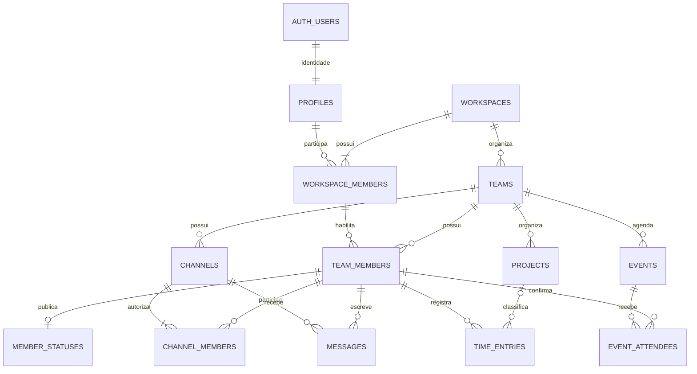

# Banco de dados — Fases 0 e 1

Baseado na [visão do projeto](project-vision.md). Nome provisório: Hub.
A migração cobre os dados e controles do MVP; as tabelas das demais fases estão
planejadas abaixo para orientar as próximas migrações.

O banco já está aplicado no Supabase. O [relatório de validação](supabase-validation.md)
registra as duas versões implantadas, os testes SQL reais e os avisos dos advisors.

## Decisões de escopo

1. **Organização (`workspace`) é o limite de isolamento.** O admin administra
   todos os times da própria organização. Não existe admin global no aplicativo.
2. **Liderança pertence ao time.** Uma pessoa pode liderar um time e ser membro
   de outro. O papel admin fica em `workspace_members`; líder/membro ficam em
   `team_members`. Papéis não vêm de metadados editáveis de Auth ou da interface.
3. **Chat exige participação explícita.** Admin e líder não recebem acesso
   automático a canais privados ou DMs. Canais públicos são descobertos pelo
   time; para ler/escrever é preciso entrar. Ao entrar, o histórico é visível.
4. **DMs são entre duas pessoas do mesmo time no MVP.** O par é único por time;
   membros comuns podem abrir DMs. Conversas entre times e DMs de grupo ficam
   para uma migração posterior, sem reaproveitar DMs de duas pessoas.
5. **Calendário é compartilhado pelo time.** Eventos não têm convidados
   externos nem visibilidade privada nesta fase. Membros criam seus eventos;
   organizador, líder do time e admin podem alterá-los e cancelá-los.
6. **Horas pertencem à pessoa.** Gestores podem consultar, mas não alterar os
   registros de outra pessoa. Não há aprovação/fechamento de horas no MVP.
7. **Identidades e históricos não são apagados pelo cliente.** Acesso é
   suspenso com `is_active`; mensagens e eventos usam remoção/cancelamento
   lógico. Exclusão definitiva de conta e retenção exigem um fluxo próprio.

Admins precisam participar do time para conversar, registrar suas horas,
publicar status ou criar um evento como organizador. Podem consultar horas e
calendários e gerenciar projetos de todos os times da organização sem aderir a
cada time. Só admins criam times e gerenciam papéis; líderes criam canais e
projetos dentro dos times que lideram.

## Relações



Todas as identidades usam UUID. Tabelas filhas carregam `team_id` com chaves
estrangeiras compostas: por exemplo, `(team_id, project_id)` só referencia um
projeto do próprio time. Associações de time também validam que a pessoa e o
time pertencem à mesma organização. Isso evita cruzar escopos mesmo em uma
gravação privilegiada que ignore RLS.

| Tabela | Conteúdo e invariantes |
| --- | --- |
| `profiles` | Nome público, avatar e último visto; PK é `auth.users.id`. Sem e-mail, senha, fator MFA ou papel global. |
| `workspaces` | Organização, nome e criador. Criada junto com seu primeiro admin em uma transação. |
| `workspace_members` | Associação à organização; papel `admin`/`member` e estado ativo. Sempre resta ao menos um admin ativo nas mutações da API. |
| `teams` | Time de uma organização. |
| `team_members` | Associação ao time; papel `leader`/`member` e estado ativo. |
| `member_statuses` | Texto/emoji/status expirável por time; `timer_running` é uma projeção mantida pelo banco. |
| `projects` | Projetos por time; arquivamento mantém o histórico de horas. |
| `channels` | Público, privado ou DM; DMs guardam o par canônico; contador ordinal por canal. |
| `channel_members` | Participação, moderação e cursor individual de leitura. |
| `messages` | Autor, texto, identificador de retry, ordinal e tombstone de exclusão. |
| `time_entries` | Timer ou lançamento manual, início/fim e duração gerada; só um timer aberto por usuário. |
| `events` | Agenda/reunião, organizador, intervalo, fuso IANA, link HTTPS e cancelamento. |
| `event_attendees` | Participação e resposta `pending`/`accepted`/`tentative`/`declined`. |

## Acesso e RLS

As 13 tabelas têm RLS habilitado. `anon` não recebe acesso aos dados do app.
`authenticated` pode ler somente as linhas autorizadas. O único UPDATE direto
do navegador é `profiles(display_name, avatar_url)` no perfil próprio; os
demais INSERT/UPDATE/DELETE são negados por grants e pela ausência de políticas
de escrita.

As mutações são RPCs `SECURITY DEFINER` que verificam `auth.uid()`, MFA, escopo e
papel antes de escrever. Elas executam com um owner confiável e podem ignorar
RLS; por isso os checks nas RPCs são parte obrigatória da segurança, e não uma
conveniência da UI. Todas fixam `search_path = ''` e usam nomes qualificados.
Helpers ficam em `private`, fora da API; só os helpers usados nas políticas têm
EXECUTE concedido a `authenticated`. Helpers que consultam outro usuário não
ficam disponíveis diretamente.

| Recurso | Quem lê | Quem altera |
| --- | --- | --- |
| Perfil próprio | O usuário autenticado, inclusive AAL1 para onboarding | Próprio nome/avatar; último visto via RPC |
| Perfil de colega | AAL2 + associação ativa à mesma organização | Somente o próprio usuário |
| Organização e membros | Membro ativo da organização | Admin via RPC de associação |
| Times e membros | Participante do time ou admin da organização | Admin via RPC |
| Status/projetos | Participante do time ou admin da organização | Status próprio; projetos por líder/admin |
| Canal público | Metadados: membros do time; conteúdo: participantes do canal | Criação por líder/admin participante; moderação por moderador do canal |
| Canal privado e DM | Somente participantes ativos | Membros enviam; autor edita; autor/moderador remove mensagem |
| Horas | Próprias; líder vê seu time; admin vê sua organização | Somente o autor ativo |
| Eventos e participantes | Participante do time ou admin da organização | Organizador/líder/admin gerencia; cada pessoa responde por si |

As próprias associações de organização/time continuam legíveis em AAL2 após
desativação, para o cliente detectar perda de acesso. Isso não libera leitura
de mensagens, horas ou eventos. Reativar uma associação à organização restaura
as associações de time que continuam ativas; timers encerrados não reiniciam.

Gravações de membership são serializadas pelo lock da organização. A API
protege o último admin e o último moderador de um canal. DMs não permitem
adicionar/remover participantes nem arquivamento global. Para sair de um canal
nomeado, a pessoa chama `remove_channel_member` com seu próprio UUID; se for o
último moderador ativo, precisa promover outro participante antes. Desativar
uma pessoa não é bloqueado por essa regra. Se o canal ficar sem moderador
ativo, `recover_channel_moderator` permite ao admin promover um participante
que já tenha acesso ao canal; não permite adicionar terceiros, entrar no canal
ou ler seu conteúdo. DMs não usam essa recuperação.

O owner do banco e `service_role` são confiáveis e ignoram esses limites. A
chave de serviço nunca deve chegar ao browser, PWA, Tauri ou Expo.

## Auth e MFA

O trigger em `auth.users` cria `profiles`; nomes vindos de metadados são
limitados a 80 caracteres, e papéis informados nos metadados são ignorados.
Usuários já existentes também recebem perfil ao aplicar a migração.

O banco exige `auth.jwt()->>'aal' = 'aal2'` para dados colaborativos e todas as
RPCs do app. O perfil próprio em AAL1 permite iniciar onboarding; não libera
dados do time. A interface deverá implementar login, enrollment de TOTP,
challenge/verify e renovação da sessão com o token AAL2 antes de consultar o
workspace. A migração não cria o fator nem implementa essas telas.

Adicionar alguém usa seu UUID de Auth já cadastrado. O convite por e-mail e a
resolução de usuário devem acontecer em um endpoint confiável com a API Admin
do Supabase, antes de `set_workspace_member` e `set_team_member`. E-mails e
listagem global de usuários não são expostos nas tabelas públicas do app.

SSO Microsoft é uma etapa posterior: autenticação federada não garante que o
JWT emitido pelo Supabase esteja em AAL2. A integração precisa validar o fluxo
de step-up suportado; não basta confiar em um campo de metadados do provedor.

## RPCs do MVP

| Área | Funções |
| --- | --- |
| Organização/time | `create_workspace`, `set_workspace_member`, `create_team`, `set_team_member` |
| Perfil/status | `touch_last_seen`, `set_work_status` |
| Projetos | `save_project` (cria, edita ou arquiva) |
| Canais/DM | `create_channel`, `join_public_channel`, `set_channel_member`, `remove_channel_member`, `recover_channel_moderator`, `set_channel_archived`, `open_dm` |
| Mensagens | `send_message`, `edit_message`, `delete_message`, `mark_channel_read` |
| Horas | `start_timer`, `stop_timer`, `add_manual_time_entry`, `edit_time_entry` |
| Calendário | `save_event`, `cancel_event`, `invite_event_attendee`, `respond_to_event` |

Os argumentos e defaults estão na migração. IDs retornados pela criação devem
ser usados nas chamadas seguintes; nenhuma RPC aceita um `actor_id` do cliente.

Exemplo para o futuro cliente Supabase:

```ts
// Reutilizar clientId em um retry desta mesma mensagem.
const clientId = crypto.randomUUID();
await supabase.rpc('send_message', {
  p_channel_id: channelId,
  p_client_id: clientId,
  p_body: 'Começando a revisão.',
});
await supabase.rpc('start_timer', {
  p_team_id: teamId,
  p_project_id: projectId,
  p_description: 'Revisão',
});
```

### Mensagens, leitura e retry

`send_message` bloqueia a linha do canal até o commit e só então atribui o
próximo ordinal. Assim a ordem do cursor não depende de timestamps do cliente
nem de uma sequence que possa ser confirmada fora de ordem.
`(channel_id, author_id, client_id)` torna o retry idempotente: o primeiro
payload vence; reenvios com o mesmo identificador retornam a mensagem existente.
Editar usa outra RPC. Ordinais não são renumerados em exclusões.

`mark_channel_read` avança monotonamente até o maior ordinal já confirmado.
A view `channel_unread_counts` usa `security_invoker=true`, considera só o
usuário atual e exclui mensagens próprias e tombstones. O frontend deve marcar
o maior ordinal que realmente mostrou, não simplesmente marcar tudo ao abrir
uma notificação.

### Horas

Início e parada do timer usam o relógio do banco. Todos os timestamps são
`timestamptz`; enviar ISO 8601 com offset/UTC e configurar a sessão em UTC evita
ambiguidade. A interface converte para o fuso da pessoa. A duração de registros
encerrados é `floor(extract(epoch from ended_at - started_at))`; timers abertos
têm duração NULL, e o contador visual não é a fonte dos relatórios.

As mutações bloqueiam a linha do perfil da pessoa. Isso serializa timer,
lançamento manual, edição e encerramento por desativação. O índice parcial de
`time_entries(user_id) WHERE ended_at IS NULL` também impede dois timers.
Lançamentos terminados não podem estar no futuro ou ter duração negativa/nula;
intervalos `[início,fim)` não podem se sobrepor, inclusive entre times.
Intervalos adjacentes são aceitos. Lançamentos manuais não têm chave de retry:
repetir o mesmo intervalo gera erro de sobreposição.

Repetir `start_timer` com mesmo time/projeto/descrição retorna o timer aberto;
com outro contexto retorna conflito. `stop_timer` é idempotente. Revogar acesso
ao time/organização encerra o timer daquele escopo na mesma transação.
Projetos arquivados preservam registros existentes e não aceitam novos timers.

O trigger de horas atualiza apenas `member_statuses.timer_running`: membros
veem o indicador sem consultar o histórico ou a descrição de colegas. Inserir
uma hora histórica não desliga um timer que continua aberto.

### Calendário

Cada evento tem início/fim UTC e um fuso IANA para exibição; recorrência e dias
inteiros serão modelados separadamente quando necessários. O criador é
inicialmente um participante com resposta aceita. Convites de outros começam
pendentes e não sobrescrevem uma resposta existente. Membros podem responder
por si em qualquer evento compartilhado do próprio time. Cancelamento mantém
histórico e bloqueia novos convites/respostas.

## Realtime e presença

| Canal de entrega | Conteúdo | Autorização |
| --- | --- | --- |
| Postgres Changes | Mensagens, canais, status, projetos, horas, eventos, respostas e associações | SELECT/RLS das tabelas publicadas |
| `team:<uuid>:presence` | Presence online/ausente/em reunião | AAL2 + participação ativa no time |
| `channel:<uuid>:typing` | Broadcast de digitando, sem persistência | AAL2 + participação ativa no canal |

Usar `config: { private: true }` no cliente e desabilitar canais públicos nas
configurações de Realtime do Supabase antes do piloto. As políticas de
`realtime.messages` cobrem os tópicos privados definidos acima e verificam
também que a linha corresponde ao tópico autorizado. A migração pressupõe um
projeto novo, sem outras políticas permissivas em `realtime.messages`.

Presence é efêmero: várias abas/dispositivos devem ser agregados por usuário;
queda de conexão só desaparece após detecção/timeout, não necessariamente no
instante em que uma aba fecha. Payloads de Presence/typing são enviados pelos
clientes e não comprovam identidade, presença ou horas trabalhadas. O status
persistido, o último visto e o indicador de timer vêm do banco.

A autorização de rooms Realtime pode ficar em cache. Ao mudar associação,
renovar autenticação e refazer/encerrar subscriptions. Não enviar corpo de
mensagem ou documento sensível por Broadcast: o histórico usa Postgres Changes
com RLS. Uma exigência de revogação imediata de Presence/typing também exige
desconexão controlada pelo backend, a validar na integração real.

`channel_members` não entra na publicação: sair de canal faz DELETE físico
nessa associação, e o serviço não aplica filtros de RLS a DELETE como aplica a
INSERT/UPDATE. Nas tabelas publicadas, os fluxos do app usam apenas criação,
edição, tombstones e desativação; exclusões físicas administrativas precisam de
um procedimento que considere a publicação.

## Evolução planejada

| Fase | Tabelas/relações previstas | Regra de integração |
| --- | --- | --- |
| 2 — Kanban | `boards`, `board_columns`, `tasks` | O card é a própria task, sem uma segunda entidade concorrente. Adicionar `task_id` às horas com FK composta para o mesmo time/projeto. |
| 2 — Chat | `message_reactions`, `message_mentions`, `message_pins`, `attachments`; `messages.parent_id` | Threads referenciam o mesmo time/canal. Reações/fixadas herdam o acesso à mensagem. Anexos usam bucket privado; Storage verifica participação atual no canal. |
| 2 — Projetos/canais | `channels.project_id` | FK composta garante projeto do mesmo time. Permissão de projeto não concede acesso automático a canal privado. |
| 2 — Documentos/rotina | `notes`, `note_revisions`, `standups`, `weekly_checkins`, `event_notes` | Escopo por time; respostas de rotina próprias. Pauta/ata associadas ao evento, respeitando sua visibilidade. |
| 2 — Notificações | `notifications`, `push_subscriptions`, `notification_deliveries` | Leitura só pelo destinatário. Workers verificam participação no envio e usam chaves privadas no servidor. |
| 3 — Clientes/relatórios | `clients`, metas, `time_periods`/fechamentos | Cliente pertence à organização; ao adicionar `projects.client_id`, validar o workspace do time. Fechamento precisa impedir edição dos registros fechados. |
| 3 — Pessoas | `shifts`, `shift_assignments`, `shift_swap_requests`, `absence_requests`, `team_dates` | Aprovação por líder/admin; registrar solicitante, decisor e transições. Dados pessoais restritos, não duplicar no perfil público. |
| 4 — Auditoria | `audit_logs` | Append-only por trigger/rotina confiável, leitura por admin do workspace. Captura anterior à sua implantação não é reconstruível a partir de `updated_at`. |
| 4 — OAuth/calendários | `integration_connections`, `calendar_event_mappings`, `sync_jobs` | Tokens cifrados/fora da API pública; IDs externos únicos por conexão/provedor; retries idempotentes. |
| 4 — Webhooks/bot | `webhook_endpoints`, `webhook_deliveries`, `command_runs` | Assinatura, escopo e idempotência no backend; identidade de bot explícita, sem fingir ser um usuário. |
| 5 — Voz/vídeo | `call_sessions`, `call_participants` | Tokens LiveKit emitidos pelo servidor após verificar canal; revogação também precisa atingir a sala de chamada. |
| 5 — Offline/desktop | Evolução de sync e preferências de dispositivo | Mesmo contrato de RPCs para PWA/Tauri/Expo; chave de cache por usuário/organização e limpeza no logout. |

O schema inicial não contém tabelas vazias de módulos futuros nem UUIDs sem FK.
Busca, anexos, push, SSO, auditoria e OAuth não estão implementados nesta migração.
O service worker da fundação deve cachear apenas assets; cache de dados
autenticados fica para a fase de offline, após definir isolamento e invalidação.

## Validação e aplicação

```sh
npm ci --prefix supabase/tests
npm test --prefix supabase/tests
```

A suíte aplica a migração inteira em PostgreSQL via PGlite e cria duas
organizações, times e usuários com papéis diferentes. Exercita leitura por
RLS, negação de escrita direta, RPCs, MFA, DMs, cursores, horas, calendário,
tópicos Realtime e FKs. Cada cenário roda em uma transação revertida.

Os 38 testes locais usam contratos mínimos simulados de Auth/JWT e Realtime.
O script `supabase/tests/phase01.live.sql` também foi executado no Supabase,
com 28 verificações bem-sucedidas e fixtures revertidas. Ele usa papéis reais
do banco com claims de teste e não passa pelo login ou pela verificação TOTP.
Os testes não simulam duas conexões concorrentes nem provam entrega/revogação
de eventos WebSocket. Antes do piloto, executar na integração do frontend:

1. Cadastro/login, enrollment/challenge/verify de MFA e refresh de JWT AAL2.
2. Os fluxos de escrita por `.rpc` e leitura por `.from`, com sessões reais
   de membro, líder, admin e usuário de outra organização.
3. Duas conexões iniciando timers para a mesma pessoa e enviando mensagens ao
   mesmo canal; conferir unicidade, commits, retries e cursores.
4. Presence/typing privados, entrega de Postgres Changes e revogação de acesso
   durante uma conexão ativa; confirmar que não há políticas Realtime amplas.
5. Desconexão/reconexão, mudança de organização e fuso horário no calendário.

As migrações `20261019231555_phase_0_1.sql` e
`20261019232146_restrict_internal_rls_helper.sql` já estão no histórico do
projeto `mjaidgzqsztwygdyzkeq`. Para outro projeto novo de desenvolvimento,
configurar a CLI Supabase, vincular o destino e revisar antes de aplicar
`supabase db push`. A migração assume a infraestrutura gerada pelo Supabase
(`auth`, `realtime`, roles e publicação), incluindo RLS já habilitado na tabela
gerenciada `realtime.messages`. Não altera o owner nem o RLS dessa tabela.
Os arquivos que simulam Auth nos testes locais não devem ser executados em
produção. O script de validação real também é destinado ao desenvolvimento e
reverte os dados que cria.
